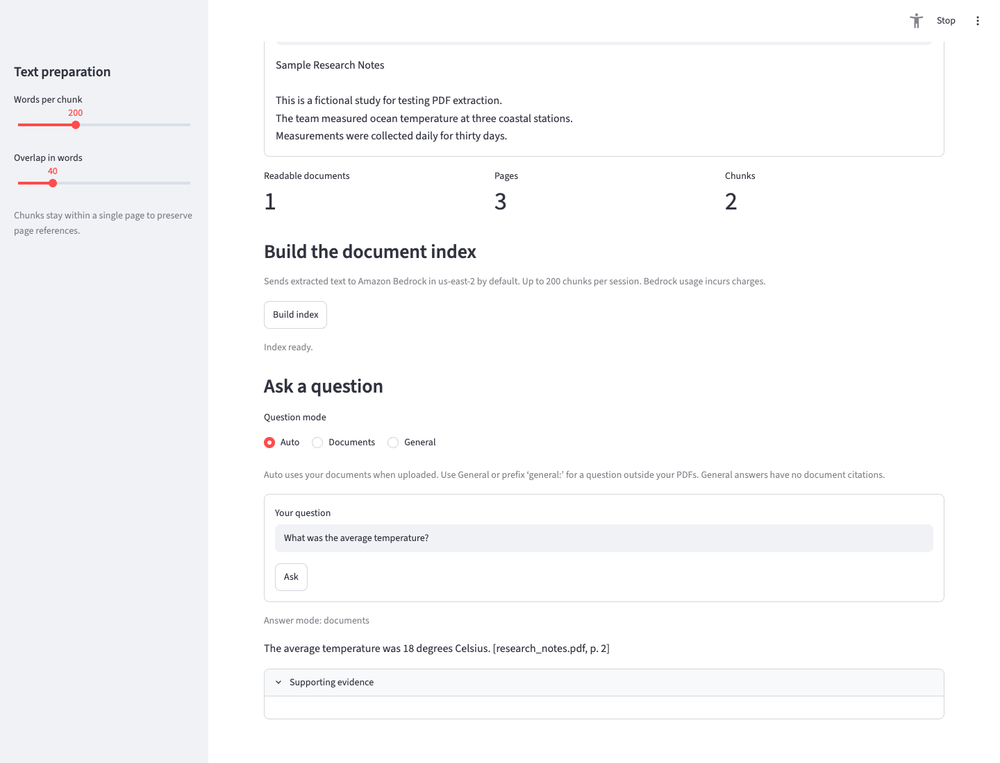
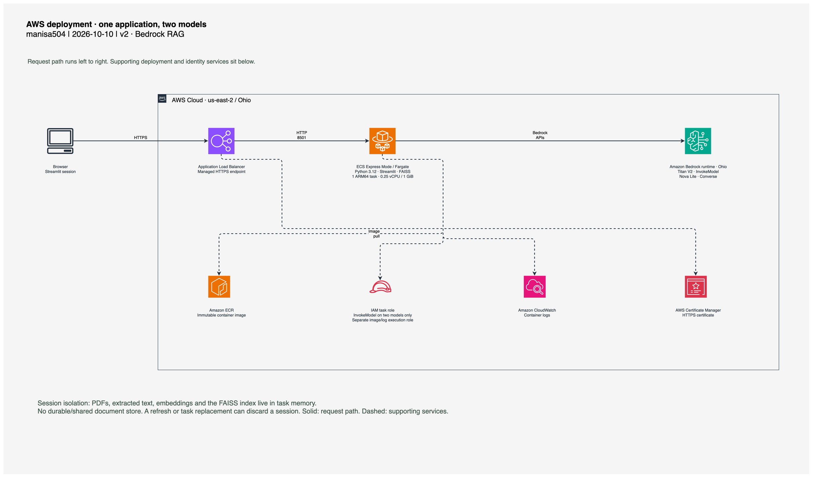
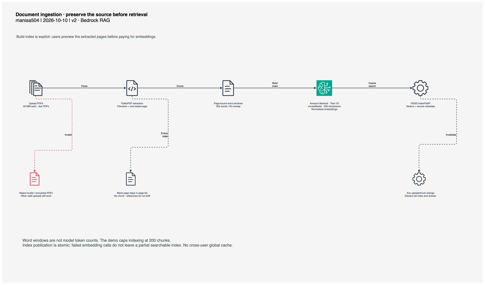
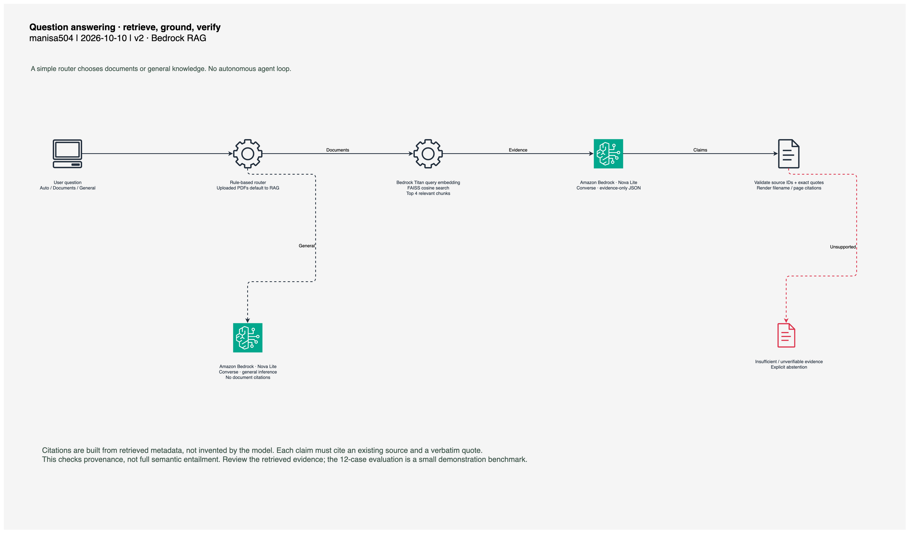

# AI Research Assistant

**Ask a PDF a question. Inspect the evidence behind the answer.**

A working Python 3.12 RAG application that turns uploaded PDFs into searchable,
page-referenced evidence using **Amazon Bedrock, FAISS, and Streamlit**. Built as
a small, readable engineering project, deployed on AWS with a dedicated task
identity and evaluated against a reproducible sample corpus.

[Launch the AWS demo](https://ai-9cc795dd20a04970bca0dd0293f8831e.ecs.us-east-2.on.aws)
· [Project walkthrough](doc/index.html)
· [Evaluation results](doc/evidence/evaluation_results.csv)
· [Deployment guide](AWS_DEPLOYMENT.md)



## What works

- Upload multiple PDFs; extract text with PyMuPDF while preserving filenames and
  one-based page numbers, including blank pages.
- Preview overlapping, page-bound text chunks. Defaults: 200 words, 40-word overlap.
- Explicitly build a session-local **FAISS IndexFlatIP** with real **Titan V2**
  embeddings (256 dimensions, normalized for cosine search).
- Ask document questions: retrieve top four chunks, generate a **Nova Lite** answer,
  and validate source IDs and verbatim evidence quotes before rendering citations.
- Abstain when support is absent or the model's evidence cannot be verified.
- Route general questions directly to Bedrock with a simple rule and a UI override.
- Clear stale indexes and answers when documents or chunk settings change.

The original Steps 1–2 restriction is superseded. Bedrock question answering is
core functionality; [AGENTS.md](AGENTS.md) records the updated completion criteria.

## A two-minute walkthrough

1. Open the demo and upload [research_notes.pdf](sample_docs/research_notes.pdf).
   This fictional fixture contains three pages: two with text and one blank.
   Expect **1 document, 3 pages, 2 chunks** at default settings.
2. Expand the file. Inspect page numbers, extracted text, and the blank-page warning.
3. Click **Build index**. The extracted text is sent to Bedrock; wait for the
   confirmation that two chunks were indexed.
4. Ask **“What was the average temperature?”** Expect 18 degrees Celsius and
   **`[research_notes.pdf, p. 2]`**. Expand supporting evidence to inspect the quote.
5. Ask **“What was the research budget in dollars?”** Expect an explicit
   insufficient-information response.
6. Select **General** and ask **“What is retrieval augmented generation?”**
   The response uses direct LLM inference and has no document citations.

Auto mode uses document retrieval whenever PDFs are uploaded. Without uploads,
questions mentioning a PDF/document/report use the document path; other questions
use general inference. Prefix `general:` or select a mode to override this rule.

## Architecture

### AWS deployment



[Editable draw.io source](doc/diagrams/aws-deployment.drawio)
· [Architecture notes](doc/diagrams/aws-deployment.md)

One Fargate task serves Streamlit behind a managed HTTPS Application Load Balancer
in **us-east-2 (Ohio)**. The task's IAM role permits `bedrock:InvokeModel` on the
two selected models. ECR, CloudWatch, and separate execution/infrastructure roles
support deployment. See the deployment guide for the App Runner constraints that
led to ECS Express Mode.

### Document ingestion



[Editable source](doc/diagrams/document-pipeline.drawio)
· [Pipeline notes](doc/diagrams/document-pipeline.md)

### Retrieval and answers

Document and query embeddings both use Titan V2 through `InvokeModel`. Nova Lite
uses `Converse` for evidence-grounded and general answers. Both calls go to the
regional Bedrock runtime in Ohio; the application does not use a cross-region
inference profile.



[Editable source](doc/diagrams/answer-flow.drawio)
· [Answer-flow notes](doc/diagrams/answer-flow.md)

## Engineering decisions

| Decision | Reason and tradeoff |
|---|---|
| Keep chunks within pages | Citations map directly to the PDF viewer; context across page boundaries may be lost. |
| Separate extraction and indexing | Users can inspect text before sending it to Bedrock or incurring inference charges. |
| FAISS cosine search in session memory | A readable local implementation without a database; indexes disappear with the session. |
| Validate source IDs and exact quotes | Reject fabricated provenance; this does **not** prove every claim is logically entailed. |
| Atomic index build and invalidation | Failed API calls never publish a partial index; changed uploads cannot reuse old evidence. |
| Scoped task role, standard credential chain | No AWS keys in code, Docker images, or application configuration. |
| Small rule-based router | Predictable behavior, inspectable code, and explicit user control. |

## Run locally

```bash
git clone https://github.com/manisa504/ai-research-assistant.git
cd ai-research-assistant
python3.12 -m venv .venv
source .venv/bin/activate
python -m pip install -r requirements.txt
aws login --profile research --region us-east-2
export AWS_PROFILE=research
export AWS_DEFAULT_REGION=us-east-2
python -m streamlit run app.py
```

Open http://localhost:8501. PDF parsing works without credentials; indexing and
answers require authenticated Bedrock access. IAM Identity Center profiles also
work. `.env.example` documents optional settings; export them in your shell
(the app does not automatically load `.env`). `boto3[crt]` supports the AWS CLI
login credential provider.

Default models: `amazon.titan-embed-text-v2:0` and `amazon.nova-lite-v1:0`.
Override with `BEDROCK_EMBEDDING_MODEL` / `BEDROCK_CHAT_MODEL`; the embedding adapter
expects the **Titan V2** request format, and changing deployed models requires a
matching IAM policy. Both defaults were invoked successfully in Ohio.

## Verification and evidence

The recorded run on **October 10, 2026** includes **39 passing offline tests** and
**12/12 passing real-Bedrock evaluation cases**. These are demonstration results,
not a claim of production accuracy. The corpus has only two text chunks, so
retrieval coverage at top two is an intentionally modest check.

```bash
python -m pytest -q
AWS_PROFILE=research python evaluate.py
python -m pip install -r requirements-dev.txt
python -m playwright install chromium
python scripts/browser_smoke.py --url https://YOUR_DEPLOYED_ENDPOINT
```

Offline tests exercise real PDF parsing/FAISS and mock Bedrock responses. They
cover overlap, blank pages, malformed/encrypted/oversized inputs, invalid vectors,
source validation, routing, upload removal, and stale-index invalidation.
`evaluate.py` makes paid Bedrock calls and records retrieval relevance, source
validity, expected-answer phrase matches, and absent-information behavior in a
[CSV](doc/evidence/evaluation_results.csv). Phrase matching is a basic regression
check; it is not a semantic judge. Each run overwrites the results.

The [browser smoke test](scripts/browser_smoke.py) exercises the actual UI:
upload → embed → retrieve → cited answer → abstention → general answer.
[Verification report](doc/evidence/verification.md) · [JUnit report](doc/evidence/pytest.xml)
· [Browser results](doc/evidence/browser-smoke.json).

## Repository map

```text
app.py                    Streamlit upload, index, question and evidence UI
document_processor.py     PDF extraction and page-bound word chunks
bedrock_client.py         Titan InvokeModel + Nova Converse adapter
rag.py                    FAISS search, evidence validation, citations
agent.py                  One routing decision and direct inference
evaluate.py               Real-Bedrock evaluation → CSV
deploy_aws.py              Docker/ECR/ECS create-or-update deployment
iam/                      Generated baseline and scoped task policy
tests/                    Offline tests and 12 evaluation cases
sample_docs/              Public fictional demo PDF
doc/                      Static portfolio site, diagrams and test evidence
brag-output/              Reproducible launch-video plan and composition
```

## Deployment, costs, and limits

[Follow AWS_DEPLOYMENT.md](AWS_DEPLOYMENT.md) for model access, IAM, Docker,
deployment, verification, costs, and cleanup. Fargate, the load balancer, IPv4,
logs, image storage, and Bedrock input/output usage incur charges. This public
demo has no application login or per-user usage quota.

PDFs are limited to **20 MiB each**; indexing is capped at **200 chunks** per
session and 12,000 characters per chunk. OCR, persistent storage, complex table
parsing, conversation memory, and production authentication are not implemented.
Uploads, text, embeddings, and FAISS stay in session memory and can disappear on
refresh, disconnect, or deployment. Local indexes are **not durable shared storage**.
One task is the steady-state target; deployments can temporarily run replacements.
Treat PDF content as untrusted and review cited evidence; prompt instructions and
quote checks do not eliminate hallucination or every prompt-injection attempt.

## Showcase assets

Preview the responsive walkthrough with `python -m http.server 8765 --directory doc`.
Open http://localhost:8765. Architecture drawings include editable sources and
companion guides. The short [project video](doc/assets/brag.mp4) uses the
[BRAG skill](https://github.com/latent-spaces/brag); drawings use the
[AWS architecture diagram skill](https://github.com/vidanov/aws-architecture-diagram-skill).
Both skills are installed locally for future work. See [doc/README.md](doc/README.md)
for the showcase's preview and asset workflow.

References: [Titan V2 request format](https://docs.aws.amazon.com/bedrock/latest/userguide/model-parameters-titan-embed-text.html),
[Bedrock Converse](https://docs.aws.amazon.com/bedrock/latest/APIReference/API_runtime_Converse.html),
[Streamlit uploads](https://docs.streamlit.io/develop/api-reference/widgets/st.file_uploader),
[PyMuPDF](https://pymupdf.readthedocs.io/en/latest/how-to-open-a-file.html).
